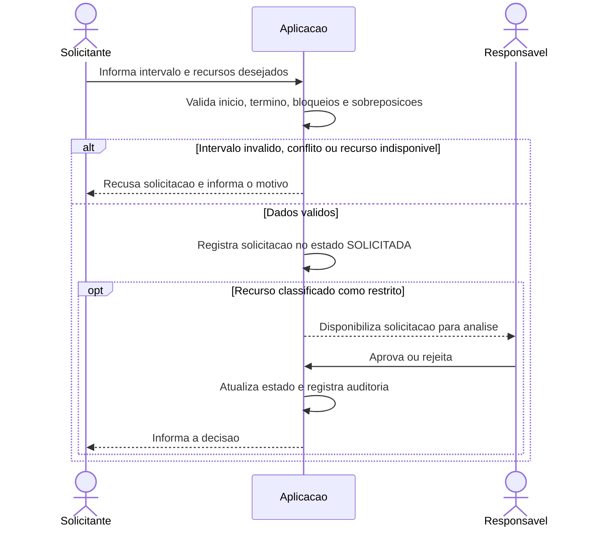
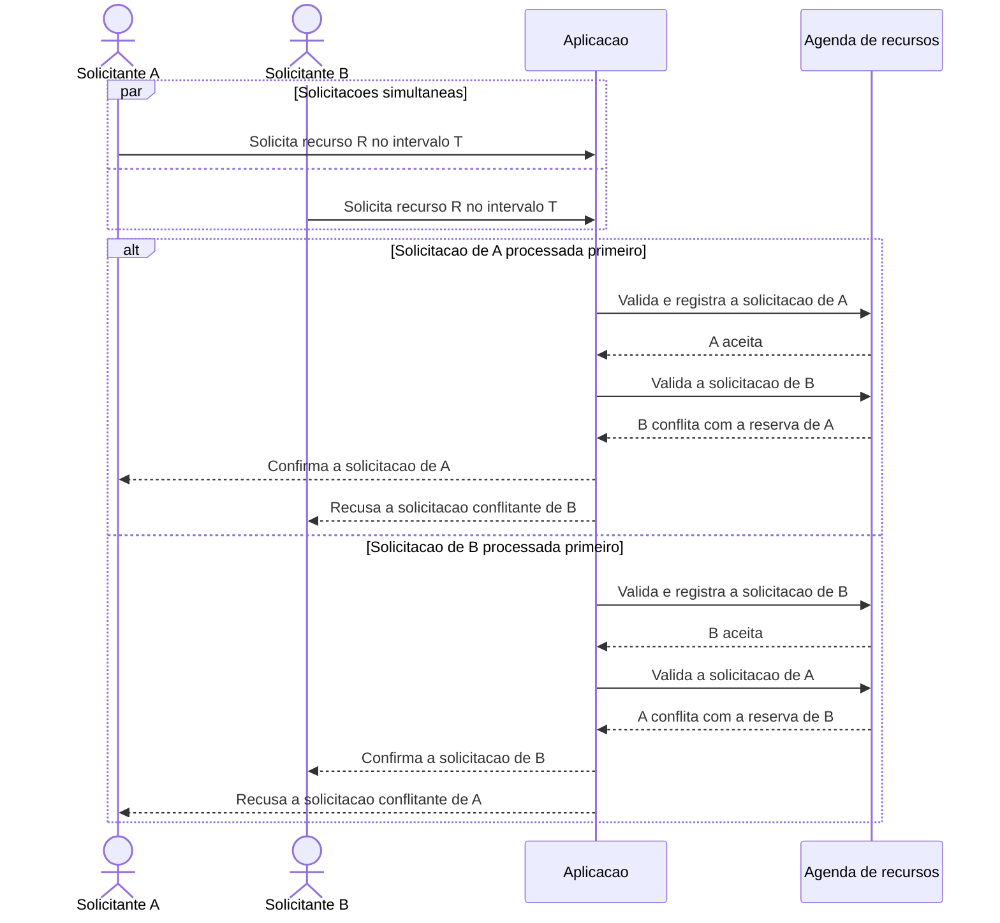
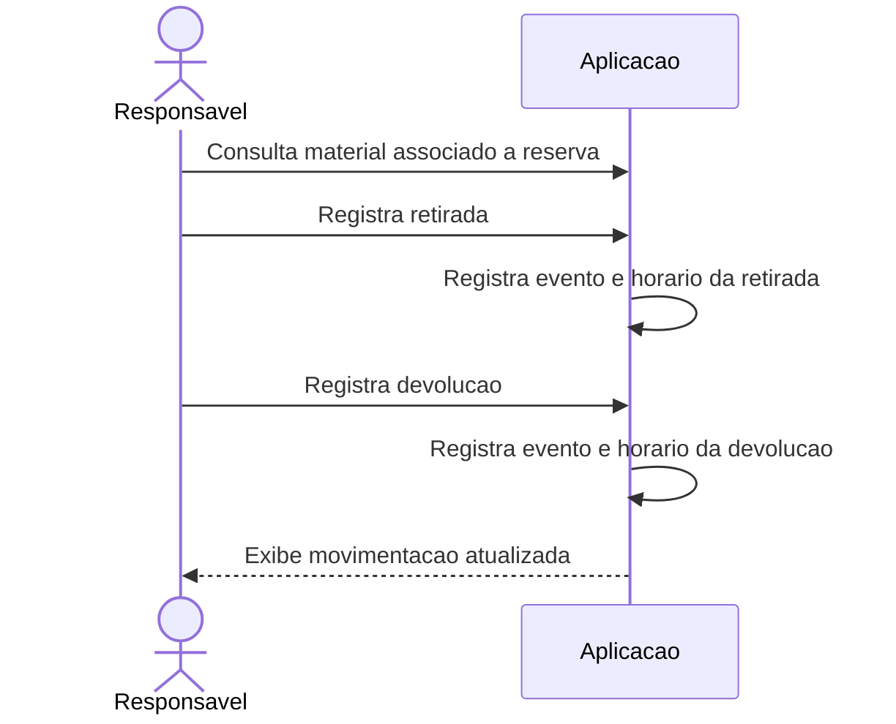

# Fluxos - Diagramas de Sequencia

Diagramas iniciais dos fluxos criticos. Os participantes representam papeis e responsabilidades, sem definir arquitetura tecnica.

## 1. Solicitar reserva e validar disponibilidade (RF06-RF11, RN01-RN05)

**Pendente:** o fluxo de aprovacao para recursos nao restritos e a regra que determina quando uma solicitacao passa a `APROVADA` ainda precisam ser definidos.

## 2. Duas solicitacoes simultaneas para o mesmo recurso (RF08-RF09, RN02-RN03)

O mecanismo interno de concorrencia nao e prescrito neste documento; o criterio e nao aceitar duas reservas conflitantes. A suite de testes deve provar o comportamento com solicitacoes simultaneas.

## 3. Retirada e devolucao de material (RF13, RN08)

## Cobertura dos fluxos

| Fluxo | Requisitos | Regras de negocio |
|---|---|---|
| Solicitacao e disponibilidade | RF06-RF11 | RN01-RN05 |
| Concorrencia de reserva | RF08-RF09 | RN02-RN03 |
| Movimentacao de material | RF13-RF14 | RN07-RN08 |