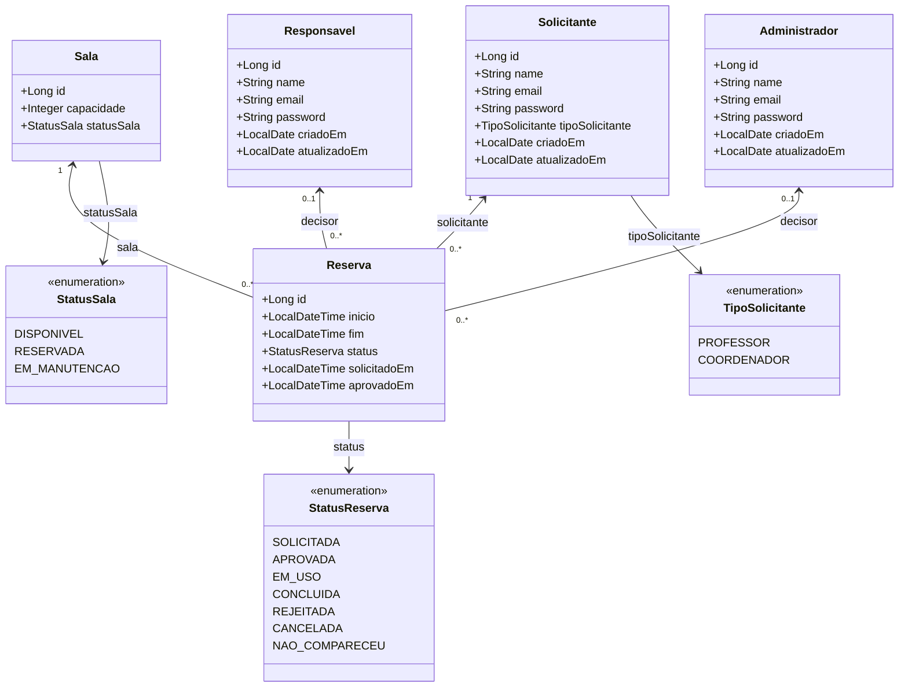

# Diagrama de Classes — Entidades do Sistema de Alocação de Recursos

**Tipo:** modelagem estática
**Status:** entidades do mapeamento JPA atual
**Relacionado:** [componentes.md](componentes.md) · [requisitos-funcionais.md](../../requisitos-funcionais.md) · [API de reservas](../../../api-reservas.md)

O diagrama delimita as entidades persistidas atualmente pelo backend. Os tipos refletem os tipos Java encontrados no código, sem afirmar tipos SQL físicos, pois o SGBD e a configuração de persistência não estão identificados no repositório.

Entidades para professores como recursos, materiais, bloqueios, movimentações e auditoria são necessidades do PRD, mas não existem no mapeamento JPA atual e, por isso, não são apresentadas como classes implementadas.

---

## Diagrama

---

## Restrições de unicidade e integridade

| Entidade | Restrição | Regra e situação atual | RFs |
|---|---|---|---|
| `Sala` | Capacidade mínima | A entidade valida capacidade mínima de 20; não foi identificada constraint SQL `CHECK`. | RF03, RF05 |
| `Reserva` | Intervalo válido | O término deve ser posterior ao início; validado na entidade. | RF07 |
| `Reserva` | Sem sobreposição por sala | O serviço consulta reservas conflitantes e usa bloqueio pessimista; não foi identificada constraint de exclusão no banco. | RF08, RF09 |
| `Reserva` | Sala e solicitante obrigatórios | Ambas as associações estão mapeadas como obrigatórias. | RF06 |
| `Reserva` | Decisor opcional | `responsavel_id` e `administrador_id` são opcionais. O serviço limpa a referência alternativa ao decidir, mas não há constraint de exclusividade declarada. | RF10 |
| `Responsavel` | `email` único | A entidade declara unicidade na tabela `responsaveis`. | RF01 |
| `Administrador` | `email` único | A entidade declara unicidade na tabela `administradores`; não há unicidade compartilhada entre os cadastros. | RF01 |
| `Solicitante` | E-mail | Há validação de formato, mas não foi declarada constraint `UNIQUE` para o e-mail. | RF01 |

---

## Mapeamento para as tabelas JPA

| Classe | Tabela | Situação |
|---|---|---|
| `Sala` | `salas` | Mapeada pela entidade JPA. |
| `Solicitante` | `solicitantes` | Mapeada; `tipoSolicitante` distingue professor de coordenador. |
| `Responsavel` | `responsaveis` | Mapeada pela entidade JPA. |
| `Administrador` | `administradores` | Mapeada pela entidade JPA. |
| `Reserva` | `reservas` | Mapeada com referências à sala, solicitante e possíveis decisores. |
| `StatusSala`, `TipoSolicitante`, `StatusReserva` | Colunas enum persistidas como texto | `EnumType.STRING` no mapeamento. |

> Ponto de atenção: os campos `password` refletem os atributos existentes nas entidades. O diagrama não confirma como os valores são armazenados nem substitui uma definição de segurança para credenciais.

O repositório não contém configuração de datasource ou migrações/DDL identificáveis. Os nomes de tabela são os declarados nas entidades; tipos físicos das colunas e constraints efetivamente criadas dependem da configuração JPA/Hibernate e do banco utilizado.
