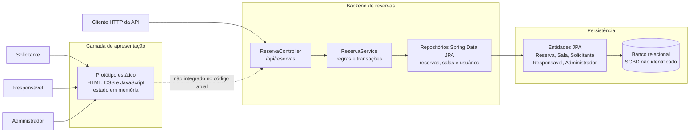

# Diagrama de Componentes — Sistema de Alocação de Recursos

**Tipo:** modelagem estática
**Status:** representação do recorte implementado e dos limites conhecidos
**Relacionado:** [classes.md](classes.md) · [requisitos-funcionais.md](../../requisitos-funcionais.md) · [requisitos-nao-funcionais.md](../../requisitos-nao-funcionais.md)

O diagrama segue o formato da referência e mostra responsabilidades e comunicação entre componentes. Ele diferencia o backend de reservas existente do protótipo estático, que ainda não consome a API. Componentes futuros não são apresentados como implementados.

---

## Visão geral

---

## Componentes e responsabilidades

| Componente | Responsabilidade | RFs | Situação |
|---|---|---|---|
| Protótipo estático | Demonstra telas e fluxos de reserva; mantém os dados em memória no navegador. | RF06, RF17 | Implementado como protótipo, sem integração ou persistência. |
| Cliente HTTP da API | Envia requisições para a API de reservas. | RF06, RF07, RF15, RF18 | Representa consumidores da API; não é o protótipo estático atual. |
| `ReservaController` | Expõe operações de solicitação, consulta, alteração, cancelamento, aprovação e rejeição. | RF06, RF07, RF15, RF18 | Implementado em `/api/reservas`. |
| `ReservaService` | Valida intervalo, solicitante, estado da sala, conflitos e decisões de reserva. | RF06, RF07, RF08, RF09, RF10, RF11 | Implementado para reservas de salas. |
| Repositórios Spring Data JPA | Consultam e persistem entidades; incluem consultas de conflito e bloqueios pessimistas. | RF08, RF09 | Implementados para as entidades atuais. |
| Entidades JPA | Mapeiam reservas, salas, solicitantes, responsáveis e administradores. | RF06, RF10, RF11, RF15 | Modelo atual; detalhes em [classes.md](classes.md). |
| Banco relacional | Armazena as entidades mapeadas pelo JPA. | Todos | O repositório não informa SGBD, conexão nem migrações. |

---

## Interfaces entre componentes

| De | Para | Conteúdo | Observação |
|---|---|---|---|
| Cliente HTTP | `ReservaController` | Requisições REST para `/api/reservas`. | Contrato descrito em [API de reservas](../../../api-reservas.md). |
| `ReservaController` | `ReservaService` | Dados da solicitação e ação pedida sobre a reserva. | IDs e tipos recebidos não autenticam a identidade do chamador. |
| `ReservaService` | Repositórios | Consulta, validação e gravação das entidades. | Operações de reserva são transacionais. |
| Repositórios | Entidades JPA | Persistência e consulta de `Reserva`, `Sala` e cadastros relacionados. | Relações e campos estão em [classes.md](classes.md). |
| Protótipo estático | Backend | Nenhuma chamada integrada no código atual. | A seta tracejada indica uma integração ausente. |

---

## Decisões e capacidades pendentes

O diagrama não decide tecnologias que não estão configuradas no repositório. Permanecem pendentes a configuração do SGBD e da conexão, a integração do protótipo com a API, autenticação e autorização por identidade, além dos fluxos de cadastro e administração.

O modelo atual trata somente reservas de salas. Professores e materiais reserváveis, bloqueios por período, manutenção, movimentação de materiais e auditoria ainda não possuem componentes ou entidades persistidas correspondentes. Consulte os [requisitos funcionais](../../requisitos-funcionais.md) para o estado de implementação.
